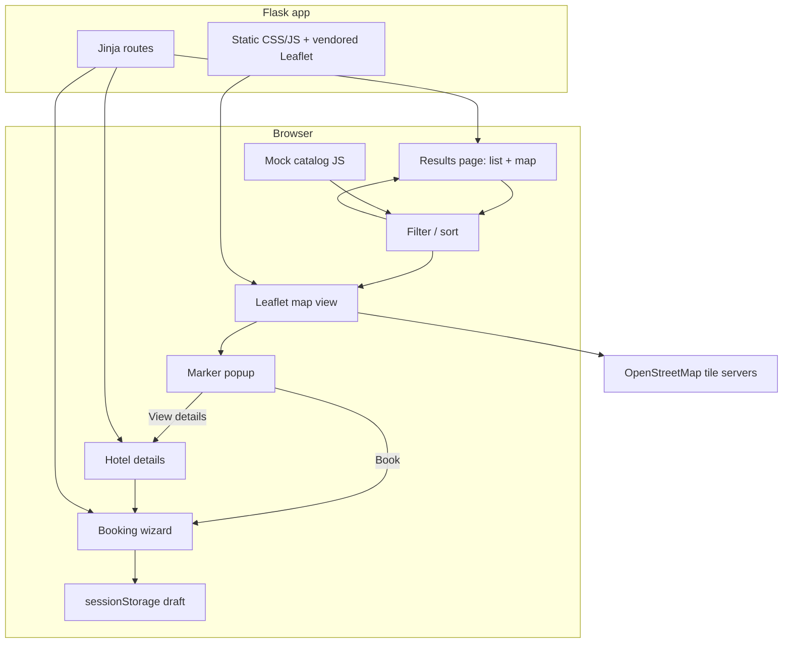
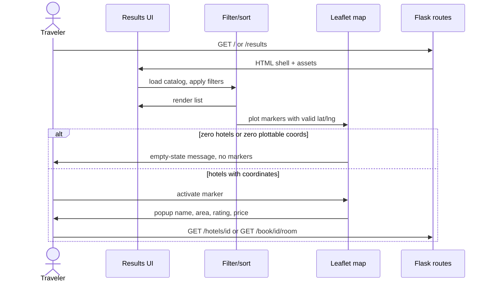

# Architecture

## Overview

HarborStay remains a **Python Flask + Jinja2** hotel booking portal. [SCRUM-5](https://vinayqa24-1792155730342.atlassian.net/browse/SCRUM-5) adds an **interactive results map**: the same mock catalog that drives the hotel list is plotted as Leaflet markers (OpenStreetMap tiles, no map API key). Marker popups show basic details and navigate to existing **hotel details** and **booking (room step)** routes.

**Baseline decision (open question 4):** Stage 5 **extends HarborStay**, not a map-only app. If application source is missing in the workspace, implementation **re-establishes** the README routes (results, details, three-step booking, confirmation) with a mock catalog, then adds the map. The booking wizard is unchanged except for inbound links from the map.

There is no database, no authentication, and no real payment gateway. Catalog, filters, sort, map markers, and booking draft live in the browser (`sessionStorage` for the draft). Flask serves pages and static assets only.

## Goals & Constraints (from requirements)

| Goal / constraint | Architectural implication |
|----|---|
| List + map on `/` and `/results` | One results template; list and map share one filtered dataset |
| Markers for hotels with valid `lat`/`lng` | Catalog schema includes coordinates; map layer skips invalid rows |
| Popup: name, area, rating, price | Popup template bound to catalog fields only |
| View details + Book from popup | Client navigation to `/hotels/<id>` and `/book/<id>/room` |
| Empty vs no-coords | Two distinct messages: `map-empty` (zero hotels) and `map-no-coords` (hotels in list, none plottable) |
| Filters update markers | Map is a subscriber of the results filter pipeline (same array as the list) |
| No map API keys; OSM attribution | Leaflet + OSM; attribution control on; no Google/Mapbox |
| No geolocation | Map never calls `navigator.geolocation` |
| ≤500 ms marker refresh on mock set | Synchronous in-memory filter + Leaflet layer replace; no geocode |
| Playwright E2E | Stable `data-testid`s; Flask test server on a known port |
| No secrets in repo | `api-conf.properties` gitignored; tiles require no committed secret |
| Restore vs greenfield | Reimplement HarborStay baseline + map (not a new product) |

## Component Diagram (mermaid)





## Components & Responsibilities

| Component | Responsibility |
|----|---|
| Flask app factory (`app/`, `wsgi.py`) | Create app, register routes, serve templates and static files |
| Route handlers | Render results, hotel details, booking steps, confirmation; unknown hotel id → in-page not-found (HTTP 200 with empty state, consistent with current README smoke tests) |
| Jinja templates | Results split layout (list + map region); details and booking pages unchanged in role |
| Mock catalog | Static hotel records including `id`, name, area, stars, price, rooms, **`lat`/`lng`** (nullable) |
| Filter/sort module | In-memory filter of the catalog; emits the current result set to list and map |
| Map view module | Init Leaflet (`keyboard: true`), `L.layerGroup` of **DivIcon** markers (`data-testid="map-marker"`, `data-hotel-id`, accessible name = hotel name), popups built with DOM/`textContent` (no catalog `innerHTML`), `fitBounds` with padding, empty/no-coords/fallback regions |
| Vendored Leaflet | JS/CSS served from `app/static/` so the map library does not require an API key or a unique CDN contract |
| OSM tiles | Raster tiles at runtime; attribution visible; no app-side cache required for ~12 hotels |
| Booking draft | Existing `hotelBookingDraft` in `sessionStorage`; map never writes it; room step hydrates from URL `hotel_id` |
| Route tests (`pytest`) | App factory and GET 200 for known routes |
| Playwright E2E | Results → marker → details; results → marker → booking; empty filters → `map-empty`; optional fixture with no coords → `map-no-coords` |

## Data Flow

1. Traveler requests `/` or `/results`. Flask returns HTML plus catalog, results, and map scripts.
2. Catalog module loads the mock array in the browser.
3. Filter/sort produces `visibleHotels[]` (same source for the list).
4. Map module (single subscriber of `visibleHotels[]`; do not re-filter the catalog independently):
   - If `visibleHotels.length === 0` → show `map-empty`, hide `map-no-coords`, clear markers.
   - Else keep hotels whose `lat`/`lng` are finite and in range (lat ∈ [-90, 90], lng ∈ [-180, 180]); if none plottable → show `map-no-coords`, hide `map-empty`, clear markers.
   - Else hide both empty regions; add one DivIcon marker per plottable hotel; on activate, popup fields via `textContent`; **View details** / **Book** are same-origin GET links (`/hotels/<id>`, `/book/<id>/room`).
5. Filter changes re-run steps 3–4. Marker refresh target: **≤500 ms** on the mock catalog. List filter/sort remains a synchronous in-memory pass (existing ≤200 ms guidance).
6. Booking wizard initializes draft from the **URL hotel id** (and catalog lookup) when entered from the map **Book** link, same as from details. Map does not write `hotelBookingDraft` itself.
7. Booking wizard and confirmation stay on existing paths; map is an alternate entry, not a parallel booking state machine.

## Technology Choices (with rationale)

| Choice | Rationale |
|----|---|
| **Flask + Jinja2 + vanilla JS** | Matches approved requirements and HarborStay README; multi-page UI without a SPA rewrite |
| Not FastAPI | No JSON API surface required for this story; HTML routes are the product |
| Not Django | No ORM, admin, or auth; Django would be heavier than the mock catalog warrants |
| **Leaflet 1.x (vendored)** | OSI-friendly, no API key, keyboard-focusable markers, popups, attribution control |
| **OpenStreetMap** tile URL | No committed secret; standard Leaflet OSM template; keep attribution |
| Not Google Maps / Mapbox | Out of scope; would require keys and billing |
| Client-side catalog | Existing pattern; coordinates are static fields, not a geocoding pipeline |
| **pytest** + **Playwright** | Route smoke + Stage 7 browser E2E against the Flask UI |
| No database | Mock catalog is sufficient for demo and tests |

## Interfaces / Contracts

### HTTP (Flask)

| Method | Path | Contract |
|----|----|----|
| GET | `/`, `/results` | Results page: list + map region (`data-testid="results-map"`) |
| GET | `/hotels/<hotel_id>` | Hotel details; unknown id → in-page not-found |
| GET | `/book/<hotel_id>/room` | Booking step 1 (map **Book** target) |
| GET | `/book/<hotel_id>/guest` | Booking step 2 |
| GET | `/book/<hotel_id>/payment` | Dummy payment |
| GET | `/confirmation` | Confirmation |

No new REST JSON API is required. Map data is embedded in the catalog script (or a static JSON file under `app/static/` with the same schema).

### Catalog record (minimum)

```text
id, name, area, stars, nightlyPrice, lat: number | null, lng: number | null
```

Invalid, missing, or out-of-range `lat`/`lng` → list row allowed, marker omitted. A coordinate is plottable only if both are finite numbers and lat ∈ [-90, 90], lng ∈ [-180, 180].

### Playwright testids (Stage 7)

| `data-testid` | Element |
|----|---|
| `results-map` | Map container |
| `map-marker` | Marker **button/div** (DivIcon), `data-hotel-id`, accessible name = hotel name |
| `map-popup` | Popup root |
| `map-view-details` | Details link |
| `map-book` | Book link |
| `map-empty` | Zero hotels in the current filter set |
| `map-no-coords` | Visible hotels exist but none are plottable |
| `map-fallback` | Leaflet asset-load failure (list still works) |

Results filters used in E2E MUST be able to produce a **zero-hotel** set (existing filter controls, or a documented test-only filter combination). Playwright locators MUST target DivIcon markers and popup links, **not** OSM tile pixels. Tests MAY stub tile HTTP.

### External

| System | Use |
|----|---|
| OSM tile CDN | Runtime imagery only; tests may stub tiles |
| Jira / GitHub | SDLC only via `api-conf.properties`; **not** used by the web app |

## Security & Secret Handling

- Web app has **no** Jira/GitHub/map API keys.
- Do not commit `api-conf.properties`, `.env`, or tokens.
- OSM tiles are public; still do not proxy secrets through Flask.
- Do not call geolocation APIs; do not store traveler location.
- Booking remains simulated; no PAN/CVV collection or storage.
- Popup DOM must be built with **`textContent` / `createElement`** only. Do not assign catalog strings to `innerHTML`.
- Generated docs never echo credentials; missing fields stay `Not Found`.

## Failure Modes & Resilience

| Failure | Behavior |
|----|---|
| Leaflet JS/CSS fails to load | Show `map-fallback` in the map region; list still works |
| OSM tiles fail | Markers and popups still work; attribution remains; optional tile-error notice if Leaflet reports it |
| Empty filter result | `map-empty` visible, `map-no-coords` hidden, zero markers |
| All visible hotels lack plottable coords | `map-no-coords` visible, `map-empty` hidden, zero markers, list still shows hotels |
| Invalid or out-of-range coord on one hotel | Skip that marker; plot the rest; page does not throw |
| Unknown hotel id in URL | Existing in-page not-found; no crash |
| Missing catalog file | Visible results error; map empty/fallback; Flask logs a non-secret reason |
| Playwright without tiles | Intercept tile URLs or allow OSM; assertions target markers/popup/empty, not pixel tiles |

## Open Trade-offs

| Topic | Decision | Residual |
|----|----|----|
| Restore HarborStay vs map-only Flask | **Restore/extend HarborStay** (baseline routes + map) | Stage 5 effort includes baseline UI if source is absent |
| List+map vs toggle vs `/map` | **Split list+map** on results (approved Stage 1 default) | Dense layout on small viewports; responsive stacking allowed |
| Leaflet+OSM vs commercial SDK | **Leaflet + OSM** | Tile availability depends on OSM; no SLA |
| Book → room step vs details-only | **Both** View details and Book (room) | Duplicate CTAs vs details page |
| Vendor Leaflet vs CDN | **Vendor in `app/static`** | Pin version + LICENSE in impl plan |
| Marker DOM | **DivIcon** with testids (not default pin image) | Slightly custom CSS vs Leaflet default pin |
| Empty copy | **Two** regions (`map-empty` vs `map-no-coords`) | Slightly more UI copy |
| Catalog in JS vs Flask-injected JSON | JS module (current HarborStay style) | Either is fine if schema matches |
| Clustering | Out of scope | ~12 hotels; revisit if catalog grows |

Stage 7 will run Playwright against this UI (happy path marker → details/booking; empty map). Design review should challenge Leaflet vendoring, empty-state copy, and baseline-restore scope only if they threaten the acceptance criteria.
