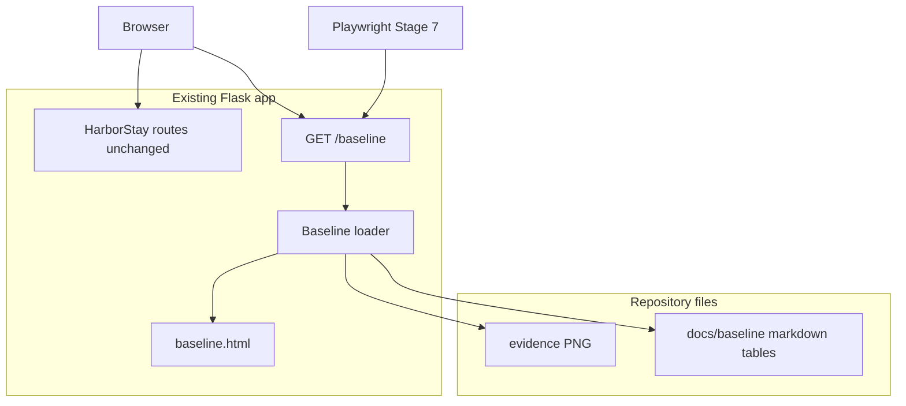
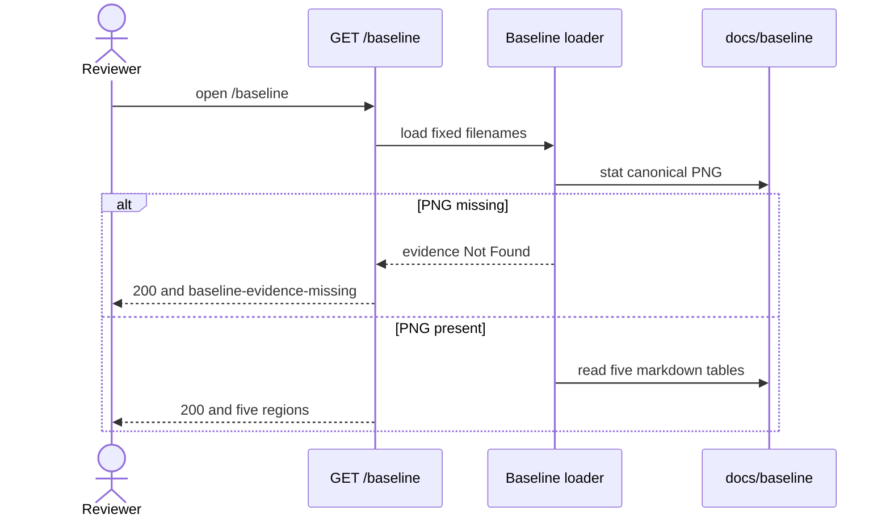

# Architecture

## Overview

[SCRUM-31](https://vinayqa24-1792155730342.atlassian.net/browse/SCRUM-31) adds a **baseline viewer** to the existing Python Flask app. `GET /baseline` renders the feature inventory, booking journey, field and failure notes, P0/P1/P2 gaps, and open questions from markdown files under `docs/baseline/`. The only UI evidence is `docs/baseline/evidence/image-20261103-075923.png` (Hotel Titan home page). The page documents that screenshot. It does not take bookings and it does not call Jira.

HarborStay routes (`/`, `/results`, hotel details, the three-step book flow, confirmation, Leaflet map) stay as they are. They are not evidence for the inventory. This document replaces the SCRUM-5 architecture as the approved design for the new cycle. SCRUM-5 map behavior is unchanged.

Stage 1 approval adopted the working assumptions in `requirements.md` Q1–Q5. Distinct search, results, hotel-details, checkout, and confirmation screens are `Not Found`. Navigation targets and validation rules that are not visible in the PNG are `Not Found`. Question owner remains the product owner role. There is no calendar due date.

## Goals & Constraints (from requirements)

| Goal / constraint | Architectural implication |
|----|---|
| One canonical PNG | A fixed evidence path. No user-supplied filenames. |
| Markdown is the source of truth | Templates contain no hotel names, fields, gaps, or questions. Request-time reads fill the regions. |
| Inventory only what the PNG shows | Content is authored in markdown from that file. The renderer does not infer extra screens. |
| Journey includes steps that are `Not Found` | Journey markdown has one row per required step; missing steps stay in the file as `Not Found` plus a gap row. |
| P0 / P1 / P2 with rationale | Gap markdown carries priority text. The page prints the priority word, not color alone. |
| `GET /baseline` and five `data-testid` regions | One Jinja page. Regions: `baseline-inventory`, `baseline-journey`, `baseline-validations`, `baseline-gaps`, `baseline-questions`. |
| Missing PNG returns 200, message, no invented rows | If the PNG is absent, render `baseline-evidence-missing` and do not render the five regions. |
| No external calls while rendering | Local filesystem only. The app does not read `api-conf.properties`. |
| Response within 2 seconds | Five small files, read on each request. No network and no cache required. |
| Playwright in Stage 7 | Stable test ids. Tests override the baseline directory so the missing-file case does not delete the committed PNG. |
| Coexist with HarborStay | New route and template only. Results, map, and booking handlers are not modified. |
| No booking storage | No POST, no session draft, no database for this page. |

## Component Diagram (mermaid)

## Components & Responsibilities

| Component | Responsibility |
|----|---|
| `app/__init__.py` `create_app` | Builds the Flask app. Sets `BASELINE_DIR` to `<parent of the app package>/docs/baseline` unless a test overrides it. The default does not use the process working directory. |
| `app/routes.py` | Keeps current HarborStay routes. Adds `GET /baseline` and `GET /baseline/evidence`. |
| `app/baseline.py` | Resolves only the known markdown names and the canonical PNG, and only if the resolved path stays inside `BASELINE_DIR`. Checks the PNG signature and size. Parses pipe tables into cell strings. Rejects a table whose header or row width does not match the contract. Returns a view model or an evidence-missing flag. Does not read HarborStay catalog data. Logs a reason code only. |
| `app/templates/baseline.html` | Renders regions from the view model with the required `data-testid` values and fixed headings (Inventory, Journey, Validations, Gaps, Questions). Jinja autoescape prints cell text. The template does not mark cell text as safe. Extends `base.html`. Page title is Baseline. |
| `app/templates/base.html` | Adds one text link to `/baseline` (`data-testid="baseline-nav"`). Brand, results, and map markup stay. |
| `docs/baseline/*.md` | Source of truth for the five regions. Authored only from the screenshot and the approved `Not Found` rules. |
| `docs/baseline/evidence/image-20261103-075923.png` | Sole UI evidence. Presence gates whether regions render. |
| Playwright specs in `tests/e2e/` | Stage 7 drives `/baseline` for the populated page and for a config whose evidence file is absent. |

## Data Flow

1. The reviewer requests `GET /baseline`. Flask does not read the query string for file paths.
2. `BASELINE_DIR` comes from app config. The default is the parent directory of the `app` package plus `docs/baseline`, not the process working directory.
3. The evidence path is `BASELINE_DIR/evidence/image-20261103-075923.png`. Each markdown path is `BASELINE_DIR` plus one fixed filename. After `resolve()`, the path must still sit inside the resolved `BASELINE_DIR`. A symlink that escapes is missing. The loader does not follow a path the request chose.
4. Evidence is present only when that path is a regular file, its size is from 1 byte through 2 MiB, and its first eight bytes are the PNG signature `89 50 4E 47 0D 0A 1A 0A`. Otherwise the loader returns evidence missing. The template responds **200** with `data-testid="baseline-evidence-missing"` and the words `Not Found`. The five region test ids are not rendered. Hotel names and form labels from markdown are not sent.
5. When evidence is present, the loader reads, in order: `inventory.md`, `journey.md`, `validations.md`, `gaps.md`, `questions.md`. Each file is decoded as UTF-8 with a leading BOM stripped.
6. A GitHub pipe table becomes header and row cells. Separator rows are ignored. The header must equal that file’s contract columns, in order, after trimming. Every data row must have the same number of cells. Zero data rows, a missing file, a file over 256 KiB, a decode error, or any row-width or header mismatch makes that region `Not Found` and drops every row from that file. Other regions still render. The loader does not invent hotel or form rows.
7. Jinja prints the cells as text. `baseline.html` does not mark cell text safe. Each region heading is fixed in the template. The PNG is shown through `GET /baseline/evidence` only when the same presence check passes.
8. HarborStay pages never call the loader. The baseline page never reads the mock catalog or `sessionStorage` booking draft.

### Markdown table contract

Implementation writes these files. Stage 2 does not author the full inventory; Stage 5 does. Columns:

| File | Columns |
|----|---|
| `inventory.md` | Feature, Screen, Section, Control, Evidence |
| `journey.md` | Step, Evidenced, Transition, Required inputs |
| `validations.md` | Step, Field, Visible placeholder, Format, Failure state |
| `gaps.md` | ID, Priority, Gap, Rationale |
| `questions.md` | ID, Question, Assumption, Owner, Due |

Journey steps, in order: search, results, hotel/room selection, guest details, submit, confirmation. Guest details and submit record the inline “Book your stay” form. The other steps are `Not Found` unless the screenshot shows them. Gap rows include at least the approved P0 confirmation gap, the P1 selection and validation gaps, and the P2 unseen carousel frames. Priority cells are the text `P0`, `P1`, or `P2`.

## Technology Choices (with rationale)

| Choice | Rationale |
|----|---|
| **Flask 3** (already in `requirements.txt`) | The repo is a Flask multi-page app. SCRUM-31 needs one more server-rendered page, not an API. A second framework would split the process. |
| **Not FastAPI** | FastAPI fits JSON services. This page is HTML with no request body. |
| **Not Django** | Django’s ORM, admin, and project layout are extra weight for five local files and no database. |
| **Jinja2 autoescape** | Cell text is data, not HTML. Autoescape is the XSS boundary. |
| **Hand-rolled pipe-table reader** | The contract is five tables. A markdown-to-HTML library is unnecessary and would be another dependency that can emit raw HTML. |
| **No new runtime dependency** | Flask, pytest, Playwright, and gunicorn already cover serve and Stage 7. |
| **Playwright** | Stage 7 runs browser checks against `GET /baseline` using the `data-testid` hooks. Existing `pytest-playwright` stays the runner. |
| **Local files, not a database** | The knowledge base for this story is the git repo. Requirements defer Jira updates. |

## Interfaces / Contracts

| Interface | Contract |
|----|---|
| `GET /baseline` | **200** `text/html`. With the PNG present: five regions with `data-testid` `baseline-inventory`, `baseline-journey`, `baseline-validations`, `baseline-gaps`, `baseline-questions`. With the PNG absent: `baseline-evidence-missing` and those five ids absent. |
| `GET /baseline/evidence` | **200** `image/png` when the PNG signature and size check pass. **404** with a short text body `Not Found` otherwise. No other evidence names are accepted. |
| `BASELINE_DIR` | App config. Default: parent of the `app` package plus `docs/baseline`, not the process working directory. Tests set it to a temporary directory. |
| Evidence filename | Constant `image-20261103-075923.png`. Not taken from the request. |
| Header link | `data-testid="baseline-nav"` points at `/baseline`. |
| HarborStay | Existing paths and map test ids stay. This story does not change their responses. |
| Playwright | Happy path asserts the five regions, their fixed headings, and visible evidence strings from the markdown (including Titan City House, “Book my stay”, a `P0` gap, and a `Not Found` journey step). Missing-evidence path uses a `BASELINE_DIR` without the PNG and asserts `baseline-evidence-missing` plus the absence of those hotel and form strings. |
| Unit tests | Temp `BASELINE_DIR` covers a valid table, a short row, a wrong header, a non-PNG file, a symlink or path that would leave the directory, and a missing PNG. These do not start a browser. |

There is no JSON API and no write API.

## Security & Secret Handling

- The baseline loader reads only `BASELINE_DIR` and the five fixed markdown names plus one fixed PNG name. It does not join user input onto a path. Resolved paths that leave `BASELINE_DIR` are treated as missing.
- `GET /baseline/evidence` does not accept a filename parameter. It runs the same PNG signature and size check as the page. A file that fails the check is **404** `Not Found` and is not sent with an image content type.
- Markdown cells are inserted as text under Jinja autoescape. `baseline.html` must not use `| safe` or `Markup()` on those cells. The table reader strips a leading or trailing pipe and ignores separator rows. It does not interpret HTML or script in cells. A table that does not match the column contract is not rendered.
- The loader logs a reason code (`missing`, `escape`, `not-png`, `too-large`, `decode`, `bad-table`) and the fixed file name. It does not log cell text, tokens, or a path outside `BASELINE_DIR`.
- The running app does not load `api-conf.properties`, Jira, or GitHub tokens. Rendering makes no outbound HTTP call.
- The screenshot is a static product image. Do not add credentials to markdown, templates, tests, or image URLs.
- `api-conf.properties` stays gitignored. Stage 5 must not commit it.

## Failure Modes & Resilience

| Condition | Behavior |
|----|---|
| Canonical PNG missing, not a regular file, over 2 MiB, or without the PNG signature | **200**. `baseline-evidence-missing` shows `Not Found`. Five regions are not rendered. |
| Resolved path escapes `BASELINE_DIR` | Same as missing. The outside file is not read and not logged by absolute path. |
| One markdown file missing, empty of data rows, over 256 KiB, or not the contract table | **200** if the PNG check passes. That region shows its fixed heading and `Not Found`. Other regions render. No partial or synthetic rows. |
| Markdown not valid UTF-8 | That region shows `Not Found`. The request still returns **200**. |
| Evidence route when the PNG check fails | **404** body `Not Found`. It does not fall back to another image. |
| HarborStay catalog or map error | Unrelated. Baseline does not import that data, so a catalog failure does not blank `/baseline`. |
| Request tries to choose a file | Ignored. Paths are constants and `BASELINE_DIR` config only. |

Unhandled exceptions from the loader are not the intended missing-file path. The loader catches file absence, decode errors, and malformed tables and returns `Not Found` for the affected region.

## Open Trade-offs

1. **Hide all five regions when the PNG is missing.** The alternative is a banner plus the markdown. Hiding the regions matches “do not render invented hotel or form rows” when evidence is gone, including rows that were typed from the screenshot.
2. **Pipe-table reader instead of a markdown library.** Prose outside the table is ignored. Region headings live in the template. A table whose header or row width does not match the contract is `Not Found` for that region. Rich markdown is out of scope.
3. **One header link to `/baseline`.** The page is also reachable by URL alone. The link does not change results, map, or booking behavior.
4. **Q1–Q4 stay open in the questions table** with the Stage 1 assumptions. Architecture does not invent screens, navigation targets, formats, or a calendar date. A later product-owner answer updates `questions.md` and, if needed, the other tables. It does not require a new framework.
5. **HarborStay and Hotel Titan share one Flask process.** They are different products on different routes. Splitting processes is unnecessary for a read-only page.
